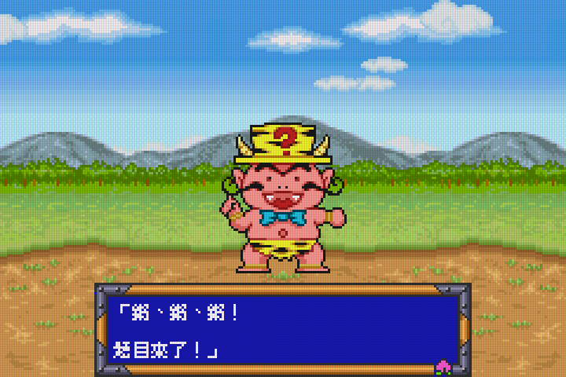
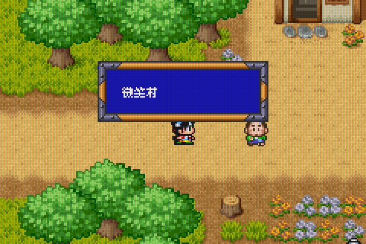
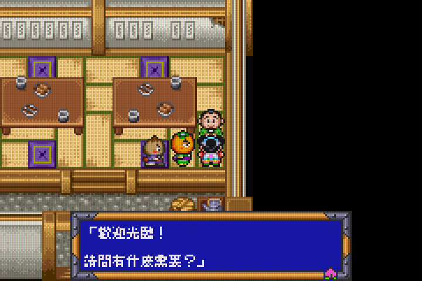
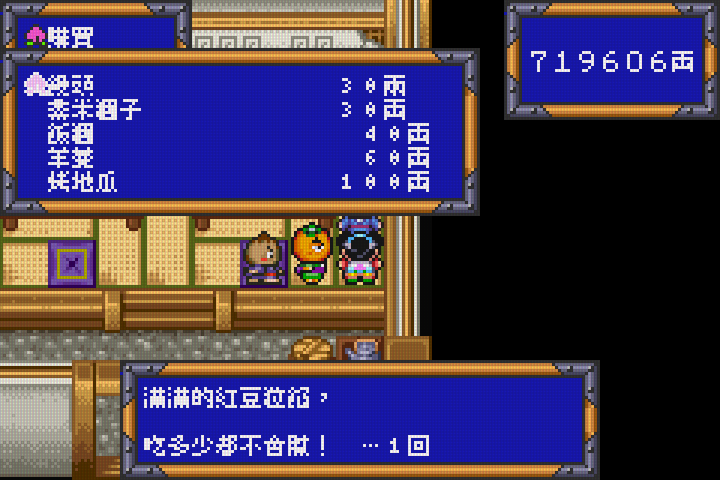

# Momotarou Matsuri: Traditional Chinese Translation


## Release

Download [momotarou-zh-Hant.ips](https://github.com/yuleshow/GBA-TW-Momotarou-Matsuri/releases/latest/download/momotarou-zh-Hant.ips) and apply it to the original Japanese **Momotarou Matsuri** ROM.

- Original ROM: `0023 - Momotarou Matsuri (J)(Rapid Fire).gba`
- Original ROM CRC32: `BF0523D1`
- Original ROM SHA-256: `938fa27a934ac3f4fa93d4d9e49bd538c2fb41040d0f7a8b2de6343a406f82d3`
- Patched ROM SHA-256: `1de651d86629da993d1a0760de36c62bb75a4634ae024a7c062a42e21f0f39b5`
- IPS SHA-256: `5cb29a1eacfd731e513768e78250b7d2cd81dbd41c2f4d7c2b10f2ab84d91f98`

The patch produces an 8 MiB GBA ROM and has been verified with the IPS roundtrip against the original release ROM.

### Screenshots






## Installed I Font Trial: 11 Hand-Edited Glyphs

Checkpoint **HTYU** resumes with the selected I sample: **11 hand-edited 8x8 glyphs**, with the other 1,847 supplemental G glyphs and every original Japanese glyph unchanged. This is a partial trial, not a complete redesigned font. [Comparison](build/font-comparison-hand-dialogue.png), [ROM](build/score-fix-hand-I-TAXO6E/momotarou-zh-Hant.gba), [IPS](build/score-fix-hand-I-TAXO6E/momotarou-zh-Hant.ips), [manifest](build/score-fix-hand-I-TAXO6E/momotarou-zh-Hant.json), [font notices](build/score-fix-hand-I-TAXO6E/momotarou-zh-Hant-font-licenses.txt). ROM SHA-256: `13af30e9dbd7c1b9bdf1565198a96890b71203ad3ad0387346b236c183eb1e89`.

The builder verifies the exact 11 changed glyphs, all 1,858 glyphs' palette/nonblank/uniqueness constraints, unchanged bytes outside the glyph library, and IPS reconstruction. [Arithmetic regression](build/score-fix-hand-I-TAXO6E/arithmetic-validation.json) passes 14 captures across four terrains; [dialogue regression](build/score-fix-hand-I-TAXO6E/even-validation.json) passes three eight-page runs, native numeric tiles and return to the house. Two dialogue screenshots were visually inspected. These controlled checks do not establish the readability of all 11 edits on the handheld or full-game compatibility. Existing mountain-race timing limitations remain.

Installed on 2026-09-29 under the unchanged `momotarou-zh-Hant.gba` filename. The previous G ROM and all **493 related save files** were backed up in [build/handheld-hand-I-trial-ihc3sX](build/handheld-hand-I-trial-ihc3sX); see the [deployment report](build/handheld-hand-I-trial-ihc3sX/report.json). Independent read-back verification passed for the installed ROM, previous ROM backup and every save backup; all handheld save hashes remained unchanged. Canonical local outputs, handheld cheats and configuration were not modified. Preserve progress, close and reopen the game, and prefer in-game Continue over restoring an old emulator snapshot with cached glyphs. Hardware gameplay and cross-build save loading remain unverified.

Rebuild with `node tools/build-miseki-font.mjs --hand-dialogue`. The **Verify I font arithmetic trial** and **Verify I font dialogue trial** tasks validate this candidate; **Verify installed I font** checks the deployment against its backup. The installer uses the separate `--hand-dialogue` profile and exact source/previous-ROM hashes. Earlier installation notes below are historical.

## Previous G Font: Miseki Mincho 8px

On 2026-09-28, the selected **G / Miseki Bitmap Mincho v1.15.2** was installed on the handheld under the unchanged `momotarou-zh-Hant.gba` filename. [ROM](build/score-fix-miseki-QCwnps/momotarou-zh-Hant.gba), [IPS](build/score-fix-miseki-QCwnps/momotarou-zh-Hant.ips), [manifest](build/score-fix-miseki-QCwnps/momotarou-zh-Hant.json), [font notices](build/score-fix-miseki-QCwnps/momotarou-zh-Hant-font-licenses.txt). SHA-256: `03b59d6022a0f9cdb86b10c38ba91b371a85dd5eda5695dd3c56ea2855bd9fb4`.

All 1,858 supplemental glyphs use native monochrome 8px outlines, one 8x8 tile each, with no resizing or cross-tile composition. This changes 460 glyphs from the preceding arithmetic build. Every ROM byte outside the 59,456-byte supplemental glyph library is unchanged: original native glyphs, numeric graphics, layout, runtime hooks and the separate static 10px house preview are retained. This is not a replacement of every original game glyph. Silver is not used for the replacement.

The rasterizer's opt-in `--outline` mode matches comparison G and bypasses Miseki's embedded bitmap rendering mismatch in CoreText. All glyphs pass bounds, palette, nonblank and uniqueness checks; 64 comparison samples match exactly, and the default Fusion raster output remains unchanged. IPS reconstruction passes. Emulator regressions pass all four arithmetic terrain configurations (14 captures, 120 frames / 120 ticks, correct/wrong/timeout paths) and all three eight-page even-number dialogue runs. These are controlled tests, not hardware acceptance; the existing mountain-race slowdown and prior background-presentation limitations remain.

The previous ROM and all **163 related save files** are backed up in [build/handheld-miseki-trial-xfjYHd](build/handheld-miseki-trial-xfjYHd). [Deployment report](build/handheld-miseki-trial-xfjYHd/report.json). Independent read-back verification confirms the installed hash, old ROM backup and all save hashes. Local canonical outputs, handheld cheats and settings were not modified. Preserve progress, close and reopen the game, and prefer in-game Continue over restoring an old emulator snapshot with cached glyphs.

Rebuild a separate candidate with `node tools/build-miseki-font.mjs`; it never auto-installs or overwrites canonical outputs. Validate the returned prefix with `node tools/score-fix.test.mjs PREFIX --arithmetic` and `node tools/score-fix.test.mjs PREFIX`. For the installed build, the **Verify G font arithmetic**, **Verify G font dialogue** and **Verify installed G font** VS Code tasks use its fixed prefix. The old dialogue/score builders still produce their previous Fusion-based variants; use the G builder to reproduce this selection.

## Previous Arithmetic Number Fix Trial

The arithmetic encounter's clipped equation and countdown digits are fixed in [this candidate](build/score-fix-P61K4j/momotarou-zh-Hant.gba), SHA-256 `69e5cec925b6712e5b0965f69a5e9630fb9d188a5dac646aea19614d4197ae29`. It was **installed on the handheld on 2026-09-27** under the unchanged `momotarou-zh-Hant.gba` filename; the canonical local ROM is unchanged. The existing mountain-race timing defect described below remains outside this fix; this is not a fully verified release.

Independent read-only verification confirmed the installed ROM hash, the previous ROM backup and all 123 related save backups; every handheld save hash is unchanged. Backup inventory: [build/handheld-arithmetic-trial-89PdVh/before.json](build/handheld-arithmetic-trial-89PdVh/before.json). The original installer did not leave a completion report; verification was completed with `node build/install-arithmetic-trial.mjs --verify` (also the **Verify handheld arithmetic deployment** task). Preserve progress, close and reopen the game to load the new ROM; prefer in-game Continue over an old emulator snapshot.

Only the verified game-28 display configuration relocates Chinese glyphs to VRAM `A000..A7FF` and the display map to `A800..AFFF`. Native digit tiles at `E000..EFFF` remain intact. The copier checks the other background's tile references and skips late commits without waiting an extra frame.

[Arithmetic regression results](build/score-fix-P61K4j/arithmetic-validation.json) cover grass, snow, forest and cave configurations: all 128 native tiles, visible Chinese glyphs, complete map commits during VBlank, actual PPU text pixels, and exactly 120 timer ticks per 120 frames. Real button inputs answer the displayed equations correctly in all four configurations; wrong-answer and timeout paths also return. These are controlled native encounter tests, not natural encounters or handheld acceptance. The controlled setup retains background mosaic in both Japanese and Chinese captures; background presentation is not certified by this test. Existing even-number regressions pass all three runs; paper-fan checks pass 3,234 assertions, with untranslated image labels still reported.

Run `node tools/score-fix.test.mjs build/score-fix-P61K4j/momotarou-zh-Hant --arithmetic`, or the **Verify arithmetic number fix** VS Code task. To test a newly built candidate, substitute the prefix returned by `node tools/build-score-fix.mjs`. Loading an old emulator snapshot may restore already-corrupted VRAM; this fix prevents the collision in newly initialized encounters, not arbitrary snapshot repair. User saves, cheats and handheld configuration were not changed.

## Previous Handheld Experimental Trial

On 2026-09-27, the user approved installing the mountain-race number candidate despite its known timing regression: a local 120-frame interval advanced the timer by only 110 ticks. Before the arithmetic update above, the handheld had [this candidate](build/score-fix-Lok0yi/momotarou-zh-Hant.gba) under the unchanged `momotarou-zh-Hant.gba` filename, SHA-256 `36f373228b3ce27dd43e2aefdd94f0b83dac79d08975c734b9166705caa07f6d`. This is **not a passing release** and adds no new translations. Hardware gameplay and cross-build save loading remain unverified.

The previous handheld ROM and all 123 related save files were backed up to [build/handheld-race-trial-M2gpI8](build/handheld-race-trial-M2gpI8); post-install hashes confirm the saves are unchanged. See the [deployment report](build/handheld-race-trial-M2gpI8/report.json). Local canonical outputs, handheld cheats and configuration were not changed. Preserve progress, close and reopen the game to load the replacement ROM; prefer in-game Continue over an old emulator snapshot. Earlier deployment statements below are historical.

## Optional Cheats

**Handheld encounter fix verified (2026-09-29):** entry 6 now uses `600008BD 0000E026` (GameShark ROM patch for `0800117A:E026`). This resolves the handheld failure described below. Read-only SSH inspection of the actual running core showed that the old colon code was received and enabled but parsed as an ordinary RAM write: zero ROM patches, with instruction `D026` unchanged even after Apply Changes. The device's `GBACheatAddVBALine` implementation lacks the ROM-patch handling present in the tested host builds. An isolated test using the exact device library confirmed the replacement parses as one 16-bit ROM patch at `0800117A`, value `E026`. After reloading the updated cheat file and applying it, live inspection found one ROM patch and the new copy-on-write ROM buffer contained `E026`; the user confirmed outdoor walking no longer triggered encounters. Native regressions and libretro off/on/off walking replay also passed. Disabling ROM patches still requires closing and reopening content; this fix does not cancel events already started.

Installation changed only `cheat5_code`, preserving the enabled state and all first-five fields. Backup: [deployment report](build/encounter-cheat-deploy-SbhrUo/report.json). Independent verification confirmed the ROM and all 177 related save files unchanged. The race colon code also remained an ineffective RAM write in this device core; it was deliberately left unchanged in this encounter-only fix. The following investigation notes are historical evidence, not the current unresolved status. The diagnostic script [build/inspect-live-cheats.mjs](build/inspect-live-cheats.mjs) uses offsets verified for this specific handheld core binary and must not be reused against another build without checking them.

**Natural arithmetic encounter control:** a subsequent input-only run from state 81 now actually reaches arithmetic oni: wait 180 frames, then 24 direction segments repeating down/right/down/left/up/right (first segment 900 frames, later segments 240). Native breakpoint `08027D9E` is reached with the cheat off, not reached on, and reached again off at segment 21. The same route in the local mGBA libretro core, with the race entry also enabled, produces [arithmetic oni with entry 6 off](build/encounter-libretro-0.png), [the field with entry 6 on](build/encounter-libretro-1.png), and [arithmetic oni after reopening without entry 6](build/encounter-libretro-2.png). Event-selection counts are 22/0/22. This supersedes the earlier lack of an actual encounter control, but the handheld failure remains unresolved; the exact handheld runtime/core is not observed. No device files were changed in this follow-up. Slot 82 wandering remained inside village map 5; the successful outdoor comparison uses slot 81 instead.

Reproduce the native diagnostic with `CHEAT_WALK_DELAY=180 CHEAT_WALK_WANDER=1 CHEAT_WALK_TRACE=1 CHEAT_WALK_STATE=build/encounter-state81.mgba`, plus the matching BIOS/ROM environment variables below. For libretro, use `CHEAT_WALK_REPLAY=1 CHEAT_WALK_WANDER=1` with that same decoded state. The native trace is diagnostic, not an assertion-based hardware acceptance test; libretro checks event selection and emits PPM frames for visual inspection. A GBA framebuffer is required before native screenshots; without one the diagnostic crashes, not the game ROM.

**Unresolved handheld failure (slots 82-87, 2026-09-28):** the live cheat file still has `0800117A:E026`, enabled `true`, handler `0`. Read-only decoding and original thumbnails confirm slot 82 is in village map 5; slots 83 and 87 contain leopard tanuki (event 29), slot 84 the fortune encounter (event 32), and slots 85-86 quiz oni (event 27). All five encounter snapshots are on world map 0, have field flags zero, and contain the same stack chain: `0803DE79`, `08000F7D`, `080011C5`. The latter is the Thumb return address of the automatic walking call at `080011C0`, inside the block that the `117A:E026` patch should skip. Thus these are evidence of the reported walking-encounter failure, not an uncovered NPC/item dispatch path. They do not reveal whether the patch was actually installed in the running core at encounter time. The source state hashes stayed unchanged; no device files were written. Existing-key-only SSH diagnosis was blocked by an unknown host key, leaving the runtime instruction unobserved. See the [slot report](build/handheld-encounters-WzUDRp/report.json) and [slot 83](build/handheld-encounters-WzUDRp/slot83.png), [slot 84](build/handheld-encounters-WzUDRp/slot84.png), [slot 85](build/handheld-encounters-WzUDRp/slot85.png), [slot 86](build/handheld-encounters-WzUDRp/slot86.png), [slot 87](build/handheld-encounters-WzUDRp/slot87.png). Re-run `node build/handheld-inspect.mjs --from-slot 82` to create a new exclusive local evidence directory. `02000000` retains old minigame data outside encounters and must not be used alone to identify an active arithmetic scene.

[Cheat file](build/momotarou-zh-Hant.cht) has six entries and is installed at `/userdata/cheats/cht/mGBA/momotarou-zh-Hant.cht` on the handheld. Generated entries are **disabled by default**; installation preserved the handheld's existing first five entries and their states (the race entry was enabled), adding only the disabled sixth entry. In RetroArch, open **Quick Menu > Cheats > Load Cheat File (Replace)**, select `mGBA/momotarou-zh-Hant.cht`, enable the desired entries and choose **Apply Changes**. Reload the file to see newly added entries. Disable and apply changes after use. **ROM-patch entries may remain active until the content is closed and reopened:** mGBA 0.10.5's libretro cheat-reset path does not restore patched instructions, unlike the standalone toggle API tested below. Preserve gameplay before closing; do not rely on toggling off alone to remove a ROM patch.

- **Battle HP refill:** refills all four allies to their individual maximum during native status updates. This is not guaranteed immunity to lethal damage.
- **Battle MP refill:** refills all four allies during native status updates; characters with maximum MP zero remain at zero.
- **Paper-fan reaction timer freeze:** only game 11's reaction phase is frozen. Preparation countdown and A input remain active. It does not freeze every minigame or the festival clock.
- **Money 999999:** sets the wallet to the native maximum. Enable only after loading gameplay, then disable after use. The modified balance remains after disabling and can be written into an in-game save. Keep a backup before using it.
- **Mountain race elapsed-time freeze:** the fifth entry, `Mountain race ONLY`, freezes game 15's current elapsed time. Enable before starting the banana-tree story race, run and jump to the finish yourself, then disable afterward. It does not rewind time, stop player movement, directly set story flags or grant the reward. The native story result compares your time against Kuritarou's benchmark. A resulting race record may persist in an in-game save.
- **No random field encounters:** the corrected sixth entry, code `0800117A:E026`, skips the map's automatic walking-encounter block, including beneficial encounters. It changes the conditional branch at `0800117A` from `D026` to `E026`, continuing at the existing NPC/interaction checks at `080011CA`. Direct NPC, scripted and item-triggered event entry points are unchanged. It does not cancel an encounter already underway or mark quests complete. The previous `08013BF4:46C0` code was reported ineffective and is superseded. **Close content, reopen the game, reload the cheat file, enable entry 6 and Apply Changes** when upgrading, so the old ROM patch cannot remain active. Disable and reopen content when automatic encounters are wanted again.

Local mGBA 0.10.5 tests cover parsing, disabled defaults, ROM-patch restoration, all four battle toggle combinations, the native timer functions and native wallet getter/setter. Isolated mountain-timer tests cover off/on/off, unchanged benchmark and native pause behavior. A controlled-entry live race on an earlier handheld ROM version additionally verifies running and jumping while time is frozen, 60 elapsed ticks after disabling for 60 frames, and freezing again after re-enabling; [live test report](build/race-cheat-live.json). Full race completion, banana-tree reward and handheld gameplay with cheats remain unverified.

The corrected sixth-entry tests ran against the installed G-font ROM (`03b59d60...`): off/on/off covers all active/moving/changed-tile combinations, preserved NPC continuation, eight event IDs through the unchanged shared gate, and direct/item dispatch with and without the `0x400` bypass flag. The old code passed its isolated probability tests but a map-dispatch probe with that flag still reached encounter initialization; the exact cause of the user's handheld failure was not independently reproduced.

An input-only replay from a read-only local decoding of handheld state 80 checks 6,862 walking branches per run: the automatic encounter block is entered 47 times with the cheat off, zero with it on, and 47 after restoring it. All three runs finish on map 10. No encounter actually started on this route even in the unmodified control, so this verifies the walking branch, not a complete encounter or quest playthrough. The real libretro API test on mGBA `0.11-1-7a12d6d` applies `E026`, retains the original shared gate, and verifies close/reopen restoration; a reset refreshes the ROM memory-map pointer after copy-on-write before observation. This is not the exact handheld core build or hardware gameplay acceptance.

The correction preserved all 163 related handheld save files, the ROM, the first five entries and their states; [latest deployment report](build/encounter-cheat-deploy-5Y3fkJ/report.json), [previous cheat backup](build/encounter-cheat-deploy-5Y3fkJ/previous.cht). Read-only verification: `node build/install-encounter-cheat.mjs --walking --verify build/encounter-cheat-deploy-5Y3fkJ`. The sixth entry remains disabled by default.

Rebuild locally with `node tools/build-cheats.mjs` (does not deploy), then validate:

```sh
cc -std=c11 -Wall -Wextra -Werror -DUSE_DEBUGGERS \
  -I/opt/homebrew/opt/mgba/include tools/cheats.test.c \
  -L/opt/homebrew/opt/mgba/lib -lmgba -o build/cheats-test
build/cheats-test
```

`USE_DEBUGGERS` matches this Homebrew library's ABI and is required before accessing `mCore.cheatDevice`.

Walking replay: set `CHEAT_WALK_STATE=build/encounter-state80.mgba`, `CHEAT_TEST_BIOS=/Volumes/share/bios/gba_bios.bin` and `CHEAT_TEST_ROM=build/score-fix-miseki-QCwnps/momotarou-zh-Hant.gba` when running `build/cheats-test`. The optional libretro check uses `CHEAT_WALK_PROBE=1` with `build/cheats-libretro-test ROM unused BIOS_DIRECTORY`; supply `DYLD_LIBRARY_PATH="$PWD/build/mgba-libretro-probe/out"` for the existing local dylib build. Neither test writes the source snapshot or ROM.

**Race cheat troubleshooting:** the user reported that the handheld timer still increases while other cheats work. The installed file and ROM match the tested versions. The user's photo confirms index 4, code `08016568:46C0`, Emulator handler and Enabled ON, on RetroArch 1.22.2 / mGBA 0.11.0. A local replay of the user's slot-51 snapshot with the matching ROM and BIOS advances 60 ticks with no cheat, then freezes for 120 frames after the libretro add-set/add-line/refresh sequence. A separate [direct libretro API test](tools/cheats-libretro.test.c), built against libretro/mgba revision `7a12d6d` (reports `0.11-1-7a12d6d`), also freezes the timer at 3301 for 120 frames. This is not the exact handheld core build and does not resolve the reported failure; no replacement code has been deployed. Both tested libretro paths leave the timer frozen after clearing cheats. Preserve progress before closing/reopening content to test a fresh core with only the race entry enabled and Apply Changes selected. The original diagnostic probe can be run with `CHEAT_LIBRETRO_PROBE=1`, `CHEAT_TEST_ROM`, `CHEAT_TEST_BIOS` and `CHEAT_RACE_STATE` pointing to the matching local inputs; neither test writes the input snapshot.

## Current Build: Minigame Number Fix

Use [build/momotarou-zh-Hant.gba](build/momotarou-zh-Hant.gba), with the matching [IPS](build/momotarou-zh-Hant.ips), [manifest](build/momotarou-zh-Hant.json) and [font notices](build/momotarou-zh-Hant-font-licenses.txt). The fixed filename is unchanged. SHA-256: `1de651d86629da993d1a0760de36c62bb75a4634ae024a7c062a42e21f0f39b5`.

The half-number defect is fixed for **even-number tanuki (game 0)** and **paper-fan timing (game 11)**. Their Chinese glyph cache now uses VRAM `9000..97FF`, with a synchronized display map at `A000..A7FF`; original numeric graphics at `E000..EFFF` remain untouched. Scene, resource-signature and active-background checks restrict this allocation to the two tested configurations. Other minigames are not covered by this fix. Japanese image labels remain untranslated.

Controlled native-game entry followed by real button inputs passes three even-number runs: original 21, fixed 19 and fixed 17. Each run covers eight dialogue/result pages and return. All 128 native tiles remain byte-identical; fixed runs check Chinese glyphs, synchronized maps and actual PPU pixels including the central number. [Fixed result screenshot](build/score-fix-tNSdli/even-fixed.png-success-page-8.png), [even-number report](build/score-fix-tNSdli/even-validation.json). Timing-game regressions pass 3,234 checks, including 7900/8700 results and all 111 native tiles. These are controlled-entry tests, not whole-game acceptance. The previous fixed-button natural route did not reach its expected NPC on this build and is not certified. Hardware and save loading remain unverified.

The house-only **L+R 10px preview** is retained: A advances seven pages, B exits. It passes 840 pixel-checked frames, exact VRAM restoration, reopening and continued play on this same ROM. Normal dialogue remains native 8px layout with supplemental Fusion Pixel Chinese glyphs.

The local previous bundle is backed up under [build/before-score-fix-wypnPA](build/before-score-fix-wypnPA). All 42 local save/state files checked during publication were unchanged. **The handheld was not updated: `/Volumes/share` was not mounted.** Restart the ROM after replacing it; old emulator snapshots can restore the conflicting graphics or old runtime state. Preserve saves and prefer the game's Continue option across builds; compatibility is not guaranteed by the filename.

Rebuild a separate candidate, using the preserved 8px baseline manifest and 10px preview bundle:

```sh
prefix=$(node tools/build-score-fix.mjs)
node tools/score-fix.test.mjs "$prefix"
SCORE_FIX_PREFIX="$prefix" node build/smallgame-runtime-check.mjs timing-original-record timing-fixed-record
build/tenpx-rom-test "$prefix.gba" build/tenpx-XTmUbb/pages.bin "${prefix%/momotarou-zh-Hant}-tenpx"
```

The score builder checks source hashes, permitted patch sites and IPS roundtrip, and does not overwrite the fixed-name output automatically. [Publication record](build/score-fix-kZT50h/publication.json). The older dialogue builder below produces the 8px baseline without this fix; running it overwrites the fixed-name output. The older strict original-layout integration test assumes only two original hooks and has not been adapted to the combined build's extra hooks; its historical passing results do not certify this build.

## Previous 8px Baseline And 10px Trial

**The following notes describe earlier builds and their verification. The current build, hash, deployment status and commands are above.**

**Bootable 10px test ROM:** [build/momotarou-zh-Hant-10px-preview.gba](build/momotarou-zh-Hant-10px-preview.gba), [IPS](build/momotarou-zh-Hant-10px-preview.ips), [manifest](build/momotarou-zh-Hant-10px-preview.json) and [font notices](build/momotarou-zh-Hant-10px-preview-font-licenses.txt). Start a new game and reach the grandparents' invitation dialogue after the opening battle. Press **L+R** there to open the 10px comparison; **A** advances through seven pages and **B** closes it. A on the final page also closes it. Release the exit button to resume the game. The original 8px dialogue remains below the comparison area. This is a scene-limited modal trial, not game-wide 10px dialogue replacement. The production ROM and device files are unchanged; do not rename this trial over the production ROM or reuse old emulator states with it.

Build with `node tools/build-tenpx-rom.mjs build/tenpx-XTmUbb`, using the verified rasterization/snapshot directory from the earlier preview. The builder compiles the ARM7 runtime, checks the base ROM and patch sites, runs an input-only mGBA test, verifies IPS roundtrip against the original Japanese ROM, and only then publishes the separate bundle. ROM SHA-256: `dfc17977742e5c5826e3ff29d6ac066fdfdb1513df563fa5db37fafcd914b34e`. Seven pages pass 840 framebuffer checks, exact restoration before game updates resume, re-entry/B exit, and continued gameplay. No host VRAM injection is used in this ROM test.

The runtime only opens when the house registers, background references and allocated VRAM match the verified snapshot. Restore bytes reside in ROM, avoiding a large IWRAM stack buffer; BG3 write-only scroll registers are restored to this scene's verified zero values. Gameplay and interrupt-driven updates pause while the modal is open. These restrictions are intentional: general text composition, synchronized dialogue/typewriter integration, other scenes, save compatibility and hardware timing remain unverified. The existing minigame score defect is not fixed by this trial.

**Earlier host-driven 10px trial:** [first-page comparison](build/tenpx-XTmUbb-live-page-1.png) and [last-page preview](build/tenpx-XTmUbb-live-page-7.png) show native Fusion Pixel 10px text above the unchanged 8px dialogue. Each complete 10x10 glyph is composed into a pixel canvas before tiling, with 14px line pitch and whole-character wrapping at 18 columns. Tile boundaries never become text-line breaks. This earlier experiment injects the canvas into a live GBA PPU; the separate test ROM above now performs its own uploads.

Reproduce with `node tools/tenpx-preview.mjs`. It checks all 1,858 supplemental characters at native 10px, byte-identical legacy 8px rasterization, whole-glyph wrapping and pixel-to-tile roundtrips. The build-local runner [build/tenpx-preview.c](build/tenpx-preview.c) reaches the grandparents scene through normal button inputs, displays seven pages for 120 frames each, and compares every completed frame with an unmodified control core. Canvas pixels match exactly; VRAM outside the allocation, palette, OAM and outside-canvas pixels remain identical. Restoration is checked for another 120 frames. [Run report](build/tenpx-XTmUbb/report.json).

The trial uses the otherwise disabled BG3 in this Mode 0 house scene: canvas at `06009000..0600A1FF`, map at `0600A800..0600AFFF`, leaving `0600C000..0600FFFF` untouched. These addresses are checked against enabled background references every frame, not assumed globally free. Battle Mode 1 cannot use BG3; minigames use different layers. Production ARM composition, typewriter/control integration, portraits and per-scene allocation remain unimplemented; transient CPU/DMA writes and hardware timing are not certified by frame-boundary comparisons. The trial does not fix the minigame defect below, modify the ROM, or read/write device saves.

Trial font: [Fusion Pixel 10px zh-Hant](assets/fonts/fusion-pixel-10px-2026.09.25/fusion-pixel-10px-monospaced-zh_hant.ttf), upstream release [2026.09.25](https://github.com/TakWolf/fusion-pixel-font/releases/tag/2026.09.25), SHA-256 `6801ea531432aa3f0e7d6422c89d858c79dd727e3369d16e5a3f0500c0a2b372`. The downloaded TTF archive SHA-256 is `7dd2d0552c7f6ffda452911fa9764f956bd0180760a2d2b8d50162c628eb44a7`, matching the release digest. Its OFL and all bundled notices are retained alongside the font. Rasterizer cell size `10` outputs 100 palette-index bytes per character; existing `8` and `16` modes retain their tiled format.

**Known rendering defect:** the Chinese cache at VRAM E000..E7FF overlaps native minigame score graphics occupying E000..EFFF. Natural paper-fan play and controlled new-record tests reproduce corrupted digits. Moving the cache to E800 is not safe: native digit variants also occupy that region. No production fix has been installed; the current ROM is not rendering-approved. Japanese image labels and banners also remain. See [the failure and ownership evidence](build/smallgame-investigation.md).

**Silver is no longer used.** The active build preserves the game's original Japanese glyphs, window dimensions, line spacing, cursor steps and dialogue controls. Additional Traditional Chinese glyphs use **Fusion Pixel 8px**, rasterized at its native size without antialiasing or downscaling. These supplemental glyphs are not the game's original font.

Open [build/momotarou-zh-Hant.gba](build/momotarou-zh-Hant.gba) in mGBA. This is the fixed filename for all future test builds; rebuilding updates the same ROM, IPS, manifest and font notices under the `momotarou-zh-Hant` prefix. The builder never writes save files. Reload the ROM after rebuilding. Distribute the IPS with its notices, not the ROM.

Ordinary in-game saves use `momotarou-zh-Hant.sav` when mGBA stores saves alongside the ROM. Keep backups and use the game's Continue option to resume across builds. Emulator save slots are snapshots of running code and memory: keeping the filename fixes discovery, but cannot guarantee compatibility after ROM changes, especially from Silver to the original-layout build. Save/load compatibility has not been verified. Press Start, release, then press Start again to open the menu.

The integrated build contains **2,300 translated records**, with **2,422 installed text pointers** and **1,858 dynamic supplemental glyphs**. It combines the existing menus, battle and overworld text with ten full-corpus catalogs, including story dialogue, tutorials, shops, item descriptions, choices and five Shift-JIS stage labels. Original Japanese name codes remain where specified. Translations are drafts, not a fully proofread or complete game localization.

The output expands from 4 MiB to **8 MiB**. New text and the dynamic glyph library occupy appended space; the two renderer hooks remain within Thumb branch range in the original padding. Both source font resources and the original window/cursor code are preserved. The IPS reproduces the expanded ROM exactly. Output SHA-256: `964a8fd57faf7911275dd3243e4d3938630a4498d74d2ab74a0bdf4912a35d2c`.

Battle-status correction: removed the extra space in the supplemental HP/MP formats. Six-column output previously wrapped inside the original five-column window and scrolled away character names. The fresh-start `GBA_TEST_SCENE=battle-status` regression now checks all four native names, supplemental labels and complete values against live RAM; the full-smoke suite also passes. [Corrected battle status](build/original-layout-QROBQc/original-battle-status.png). Window dimensions and saves are unchanged. The separate minigame graphics defect above remains unresolved.

**Coverage limits:** 17 genuine text drafts have no proven caller and are not installed; see [translations/full-10.zh-Hant.json](translations/full-10.zh-Hant.json). Other excluded candidates are diagnostics, binary data, covered fragments or coincidental pointer values inside graphics/audio resources. Raw `blocked` and `missing` counts include these exclusions and do not measure untranslated gameplay. All 394 no-pointer extraction candidates have audit classifications, but computed references, other encodings, compressed text and image-only lettering remain unverified. Catalog coverage must not be presented as full-game completion.

The resource audit rejects 25 false references, excludes 24 resource-only records and retains the real pointer for the mixed-reference record `131208`. All **1,057 identified compressed-resource and PCM spans** remain byte-identical. This includes a startup regression where a coincidental pointer inside compressed graphics previously caused a black screen. Unidentified resource formats and pointer owners remain a limitation.

Follow-up ownership work resolves seven additional arithmetic matches as graphics/map or music data; run `node tools/trace-unreferenced.mjs` to reproduce those assertions. Controlled minigame tests now cover timing-game rules, preparation, rank advancement, an ordinary rank-10 result, and return; fixed-stage failure and rule refusal also return correctly. Six checker cases include two expected diagnostic failures and four completed cases, with 178 checks and 40 captures. All 17 old string starts were watched with positive controls and were not read in these runs. This does not prove them globally unreachable: natural NPC entry, stage success, other ranks, DMA and interior-only reads remain unverified. Details and reproduction: [smallgame investigation](build/smallgame-investigation.md). ROM and saves are unchanged.

Verified on the integrated ROM in mGBA: startup, the naturally reached seven-page grandparents' festival invitation and its exit, battle commands, item names/help, menu cancellation and cursor movement. The focused suite checks 13 captures, both original font resources against live VRAM, IPS roundtrip, source/pointer/resource preservation and permitted allocations. It does not play through all translated events. Save/load, the full closing speech, later events, minigames and real hardware remain unverified.

**Natural gameplay acceptance:** two reset-to-return runs reached the festival-village paper-fan NPC on map 6 (actor 9, script `0814e314`), entered game ID 11, earned 7900 points in three rounds, received the rank-up/card reward and returned to the same NPC. The second run replayed only fixed button durations and matched all logged event frames; neither run loaded a save or changed RAM/ROM/registers. Gameplay flow passes, but the result digits are visibly corrupted by the cache conflict above. Other stalls, stage-game success and save persistence remain unverified. [Route, evidence and screenshots](build/natural-play-report.md); reproduce with `node build/natural-play-acceptance.mjs`, or recheck existing evidence with `--check`.

Controlled timing replay additionally earned 7900 then 8700 through button inputs, triggering the actual new-record branch and three Chinese result pages. The strengthened native-bank regression fails on 16 of 111 native tiles per page, including eight digit tiles; correct dialogue glyphs do not make that rendering pass. Japanese score labels and the new-record image banner were localized to their source assets, but replacement artwork is not installed. [Image-resource investigation](build/image-localization-report.md).

Integrated-build screenshots: [battle](build/original-layout-vKeLGD/original-battle.png), [items](build/original-layout-vKeLGD/original-items.png), [grandparents](build/original-layout-vKeLGD/original-grandparents-1.png), [damage](build/original-layout-vKeLGD/original-damage.png).

Earlier 104-record builds additionally passed natural status-NPC and peach-stage tests. Higher growth stages were selected through guarded emulator-only EWRAM changes; separate redirects exercised tutorial text, highlights, palette resets, final pages and event return. These controlled checks are not proof of natural progression through every growth stage. No redirects or test memory changes are included in the shipped ROM. The encoder preserves reviewed control operands and ordered format arguments, validates source bytes and checks verified dynamic-string buffer bounds. Both pre-existing saves were unchanged by the integrated rebuild; loading them remains unverified.

Build from the repository root on macOS with Node.js 22+, Swift/CoreText and devkitARM tools on PATH:

```sh
node tools/build-dialogue.mjs --full --check
node tools/build-dialogue.mjs --full
node --test tools/rom.test.mjs
node tools/full-inventory.mjs --validate
node tools/audit-text-pointers.mjs
```

Use `--full` to include the complete reviewed catalog set. Without it, the builder produces the smaller legacy 104-record build under the same fixed filename. `--check` is read-only; `--require-complete` rejects the currently incomplete heuristic inventory and is not a whole-game completion certificate.

The builder uses [assets/fonts/fusion-pixel-2026.09.01/fusion-pixel-8px-monospaced-zh_hant.ttf](assets/fonts/fusion-pixel-2026.09.01/fusion-pixel-8px-monospaced-zh_hant.ttf), SHA-256 `94456bf00a477df7c9cd6dedac5f6d53dce3faf6e5ddde60ab25099e82b2f1fb`. It includes the SIL OFL and all bundled upstream notices in the generated font-license file. Original ROM SHA-256: `938fa27a934ac3f4fa93d4d9e49bd538c2fb41040d0f7a8b2de6343a406f82d3`.

Compile the optional mGBA capture utility on this Homebrew installation and run the active integration suite:

```sh
cc -std=c11 -Wall -Wextra -Werror \
  -I/opt/homebrew/opt/mgba/include tools/capture.c \
  -L/opt/homebrew/opt/mgba/lib -lmgba -o build/capture
GBA_TEST_SCENE=full-smoke node --test tools/original-layout.test.mjs
node --test tools/rom.test.mjs tools/original-layout.test.mjs tools/large-text.test.mjs
```

The earlier full regression passed 46 tests with one retired Silver test skipped, in about 294 seconds. After adding native resource-ownership coverage, the unit suite passes 46 tests and the 13-capture full-smoke suite still passes. These suites do not cover the newly failing numeric-bank acceptance: `node build/smallgame-runtime-check.mjs timing-original-record timing-fixed-record` currently fails and must remain a release gate. Runtime captures use unique `build/original-layout-*` directories to avoid concurrent test collisions. VS Code's `Test Chinese localization` task runs the original regression suite. `--large-text` fails with a retirement notice. Old Silver ROMs and their dedicated layout catalog are retained only as historical artifacts.

## Historical Silver Notes (Retired)

**Everything below describes earlier builds, not the active font or recommended commands.** Use the build and test commands above. The Silver-specific hashes, coverage counts, captures and layout descriptions below are retained as development history.

Target: a full Traditional Chinese (`zh-Hant`) translation of the Japanese GBA game.

**Status: the native-size Silver UI experiment has 53 localized records, not a full translation.** It covers startup options, opening-battle commands, technique/item lists and help, character names and HP/MP status, battle actions, damage/recovery results and selected paged dialogue. Unconverted text remains original Japanese. The earlier 90-record reduced-font build is retained for development but its Chinese lettering is too small. The original archive and extracted Japanese working copy are unchanged.

Use [build/momotarou-zh-Hant-silver-large-experimental.gba](build/momotarou-zh-Hant-silver-large-experimental.gba) in mGBA. Press Start, release it, then press Start again to open the menu. Test with a separate save. Distribute only the matching IPS with its font attribution, not the ROM.

## Earlier Reduced-Font Build

This 90-record build is a development artifact, not the recommended readability test. Use the native-size build above for readable Chinese.

Open `build/momotarou-zh-Hant-dialogue-experimental.gba` in mGBA. Press Start to skip the demo, release it, then press Start again to open the menu. Select New Game to play the translated opening battle.

The matching `.ips` patch applies to the exact source revision below. The `.json` manifest records inserted text, pointers, renderer hooks, allocations and hashes. Keep the generated `-font-licenses.txt` alongside distributed patches; do not distribute the ROM. Use separate saves for testing.

This build adds [translations/battle.zh-Hant.json](translations/battle.zh-Hant.json) and [translations/overworld.zh-Hant.json](translations/overworld.zh-Hant.json) to the menu prototype. Its dynamic library has 370 Silver glyphs. Unlike the menu-only prototype, it patches two text-renderer instruction sites.

Verified with the current Silver build in mGBA: Chinese startup and battle commands, progression through the opening to the house, Chinese house inspection, and exiting the house. Technique/item menus and help, attack and numeric damage messages were reviewed with the previous Fusion Pixel build, not re-reviewed with Silver. Most individual village lines and the entire closing conversation have not been visually reviewed. Save/load, later progression, minigames and real hardware remain unverified. Terminology and translations are drafts.

Four new records at `0x15311B`, `0x153163`, `0x153187` and `0x1531A7` preserve embedded `06 00` controls. Their portrait display, text, paging and return to gameplay were tested by redirecting house inspection in emulator memory after normal opening progression. These are isolated rendering checks, not natural event, choice-branch or reward checks. Final VRAM glyphs were matched against the Silver library. The deliverable ROM contains only the intended original pointer replacements, not the inspection redirects.

## Native-Size Silver Experiment

Open [build/momotarou-zh-Hant-silver-large-experimental.gba](build/momotarou-zh-Hant-silver-large-experimental.gba) in mGBA. The matching IPS, JSON manifest and font attribution use the same `silver-large-experimental` prefix. This separate build does not overwrite the small-text dialogue ROM.

The layout catalog is [translations/readable-ui.zh-Hant.json](translations/readable-ui.zh-Hant.json): 19 labels/help records, 24 dialogue records, four dynamic battle results and four battle-owned names. Two additional status formats use ASCII `HP%3d` and `MP%3d`, preserving the numeric arguments. Startup options and battle lists use two-tile row spacing with matching cursor steps. Status windows are one row taller; battle menus start one row lower. The target selector also fits native names. Selected dialogue is split into short pages. This build restores original pointers for text without a native layout; all displayed Chinese uses native Silver, while unconverted text uses the original Japanese font. Reduced-font base assets remain in unused ROM padding, not in the active font resource.

Silver is rasterized at 19pt on integer coordinates without antialiasing. CJK forms are about 11-12 pixels wide and 12 pixels tall, placed without reduction in 16x16 cells. Four 8x8 quadrant tiles form each character. The library contains 562 unique quadrant tiles for 147 native characters. The cache expands to 128 slots at VRAM `0x0600E000..F000`, reclaiming the unused reduced-font bank without replacing original Japanese glyphs. Eighteen scoped instruction hooks and nine layout patches are recorded in the manifest; the small build retains its original 64-slot configuration.

The current fixed-height dialogue window supports **one native-size line per page, at most 9 characters**. The encoder keeps a conservative 56-tile per-page budget within the shared 128-slot cache. Native characters are emitted as top and bottom tile rows, so the original typewriter animation can briefly show partial characters. Scroll-based paging shifts later pages down one tile row but keeps both halves inside the frame; two separating newlines clear the previous page completely. Single-tile Japanese quote tokens are omitted from these reviewed native layouts to avoid misaligning the quadrants.

Verified in mGBA: startup labels, battle commands, technique/item names and help, cursor movement and nested cancellation, four status names and target-selection names, HP/MP display matched to live game values, the naturally reached hope taunt and enemy-attack text, progression to the house, inspection, portrait paging, three-page story layout, and return to the exterior. Pixel checks verify aligned quadrants and no stale halves after paging; screenshots were also inspected. All three startup options were exposed using an emulator-only option-count patch, without selecting Continue or Erase. The portrait/story tests redirect inspection and three additional taunts redirect the hope line only in emulator memory; they do not prove those original events' behavior. No test redirects are active in the shipped ROM.

Battle results preserve the original `%s`/`%d` argument order. They display the native recipient name on one page, then a native result label with the original-size numeric value below it. Dynamic names are limited to the verified three-character battle-name table, and expanded buffer length is checked. Natural gameplay tests compare displayed player damage and HP/MP recovery with memory-state deltas, including a nonzero MP recovery item. Enemy damage rendering is checked without independently verifying the combat calculation. All ten newly converted action messages have their final pages tested using isolated emulator redirects; healing, item use and the following companion action were also exercised naturally.

Result captures: [damage](build/large-player-damage.png), [HP recovery](build/large-heal-result.png), [MP recovery](build/large-mp-result.png), [companion action](build/large-heal-next.png), [final invocation page](build/large-action-168286.png).

Remaining limitations: most dialogue and menus are still Japanese. Individual story events, save/load/delete, later progression, other dialogue/choice windows, cache behavior on all screens and real hardware remain unverified. Additional page waits change dialogue pacing. This is a partial readability fix, not a complete translation.

Example captures: [translated screenshot scene](build/large-hope-taunt.png), [target selection](build/large-status-target.png), [startup](build/large-start-three-options.png), [battle](build/large-battle.png), [techniques](build/large-techniques.png), [items](build/large-items.png), [natural battle dialogue](build/large-natural-battle-dialogue.png), [story page 3](build/large-story-page3.png), [portrait page 2](build/large-portrait-page2.png).

Build after installing the same prerequisites as the dialogue build:

```sh
node tools/build-dialogue.mjs --large-text
node --test tools/rom.test.mjs
```

After compiling `build/capture` as described below, run the separate emulator integration test (about two minutes on this installation):

```sh
node --test tools/large-text.test.mjs
```

The integration test requires both generated dialogue ROMs. It audits the IPS roundtrip, source preservation, pointer destinations, layout patches, allowed modified regions and native glyph tiles, then regenerates `build/large-*.png` and memory dumps. It leaves both ROMs unchanged. There are 18 JavaScript unit tests plus this integration test.

## Try The Prototype

Open `build/momotarou-zh-Hant-menu-prototype.gba` in mGBA. Press Start to skip the demo, release it, then press Start again to open the menu. The New Game label is now Traditional Chinese. The first press alone does not enter the menu.

`build/momotarou-zh-Hant-menu-prototype.ips` applies to the exact source revision listed below. Its generated JSON manifest lists all 20 translated labels and changed pointers. Keep the generated `-font-licenses.txt` file alongside any distributed patch. Do not distribute the ROM.

Silver is reduced to the existing 8x8 tiles; this is not its native pixel size. Dense Chinese characters lose detail and remain difficult to read. Larger native-size lettering requires renderer and layout work, not just a font swap. Only the start menu and entry into the opening have been exercised in the emulator; the other translated labels still need in-game layout review. Save/load and full-game progression are not verified. Use a separate save file for experiments.

## Current Results

- Fingerprinted the supplied 4 MB ROM: game code `AMMJ`, revision `1`, valid header checksum.
- Recovered hiragana and katakana mappings from the game's conversion tables.
- Extracted 2,491 heuristic text candidates with original offsets and bytes, including pointer-targeted records with zero-valued `05`/`06` operands. This is not a complete or verified script inventory.
- Inserted 20 Traditional Chinese labels from [translations/menus.zh-Hant.json](translations/menus.zh-Hant.json), including New Game, Continue, Erase Data, inventory, save options and yes/no.
- Decoded both compressed font resources and verified exact equality with live mGBA VRAM.
- The menu-only prototype adds 36 Chinese glyphs without replacing original Japanese glyphs or patching executable instructions. Strings and an expanded font are relocated into trailing ROM padding.
- Confirmed Chinese glyph indices in the live start-menu tile map and tested entry into the opening.
- The earlier dialogue build has a 370-glyph Silver library and a 64-slot dynamic cache. The native-size build uses 128 slots. Both protect tiles referenced by the text tile map and pass native cache tests under address/undefined-behavior sanitizers. There are 18 JavaScript unit tests and a separate mGBA integration test.
- Both builders reject blank, identical or invalid-palette glyph tiles. The rasterizer rejects missing or oversized glyphs. These checks do not establish readability.

## Reproduce

Run commands from the repository root. Requirements: Node.js 22 or newer and `unzip`. Supply your own matching ROM archive in `assets/`; no ROM is distributed by these tools.

```sh
node tools/inspect-rom.mjs
node tools/extract-text.mjs
node --test tools/rom.test.mjs
```

Build the prototype on macOS with the Swift compiler and CoreText:

```sh
node tools/build-prototype.mjs
```

Build the dialogue experiment with devkitARM's `arm-none-eabi-gcc`, `arm-none-eabi-as`, `arm-none-eabi-ld`, `arm-none-eabi-objcopy` and `arm-none-eabi-nm` on PATH:

```sh
node tools/build-dialogue.mjs
cc -std=c11 -Wall -Wextra -Werror -fsanitize=address,undefined \
  tools/glyph-loader.test.c -o build/glyph-loader-test
build/glyph-loader-test
cc -std=c11 -Wall -Wextra -Werror -fsanitize=address,undefined \
  -DGLYPH_SLOTS=128 tools/glyph-loader.test.c -o build/glyph-loader-128-test
build/glyph-loader-128-test
```

The dialogue builder rebuilds the menu prototype first. It reads source records with a bounded scan that skips `05`/`06` operands, including NUL; verifies exact source records; preserves dialogue controls in the reduced-font build and ordered `%s`/`%d` placeholders in both builds; enforces a conservative encoded-length limit; checks original hook instructions; and verifies IPS roundtrip equality. Native layouts deliberately replace original quote/newline/wait sequences with reviewed quadrant rows and page waits. Other control operand widths remain unresolved. These checks do not prove all game-specific buffer sizes or layouts are safe.

The builder checks both source-ROM and font hashes, validates source strings, checks padding capacity and verifies that applying its IPS reproduces the output ROM exactly. It overwrites only its generated `build/` artifacts.

The active font is [Silver by Poppy Works / Wolfgang Wozniak](https://poppyworks.itch.io/silver), supplied at [assets/fonts/Silver.ttf](assets/fonts/Silver.ttf). Font SHA-256: `d7a15f3eef3f67809b2ca6c1f457fbbc7b86defdee8d7704f4136adf7c3d532e`. The upstream page lists CC BY 4.0 and additionally asks productions exceeding $100,000 in total spend or earnings to obtain a direct license. Attribution, links, the upstream condition and adaptation details are in [assets/fonts/Silver-LICENSE.txt](assets/fonts/Silver-LICENSE.txt) and copied alongside both patches.

The earlier builds rasterize Silver at 11pt into 8x8 two-color tiles using grayscale coverage, normally thresholded at 96/255. Tiny marks use their peak coverage if lower, preventing blank punctuation. All 370 small glyphs are nonblank and distinct, but dense forms remain compromised by downscaling. The native build instead uses the 19pt rendering described above. Earlier Fusion Pixel files and their licenses remain under `assets/fonts/fusion-pixel-2026.09.01/` for reference and are not used by the current builds.

The extractor writes `build/text-candidates.json`. Both tools accept a ROM or ZIP path as their first argument; the extractor accepts an output directory as its second argument. Inspection and extraction reject unsupported source hashes.

Candidate boundaries are estimated using NUL separators and byte-frequency filters. An additional pass scans aligned ROM pointer targets, treating the byte after `05` or `06` as an operand even when it is NUL. Each entry records its `boundaryMethod` (`nul-heuristic` or `pointer-control-aware`); accepted pointer-target results replace same-offset NUL candidates. Other controls remain unresolved, pointer ownership is unverified, and overlapping candidates are retained for review. Candidates can still be incomplete or false positives. `<KANJI:XX>`, `<06:XX>` and `<XX>` tokens preserve unresolved values; they are not translations. Do not use this catalog as an insertion script.

Optional capture on this Apple Silicon Homebrew installation, with mGBA 0.10.5 installed:

```sh
unzip -n -j 'assets/Momotarou Matsuri (J)(Rapid Fire).zip' -d build
cc -std=c11 -Wall -Wextra -Werror \
  -I/opt/homebrew/opt/mgba/include tools/capture.c \
  -L/opt/homebrew/opt/mgba/lib -lmgba -o build/capture
build/capture 'build/0023 - Momotarou Matsuri (J)(Rapid Fire).gba' \
  build/boot 180:0 > build/capture.log
build/capture build/momotarou-zh-Hant-menu-prototype.gba \
  build/chinese-start-menu 900:0 2:8 180:0 2:8 180:0 > build/capture.log
```

Capture steps are `frames:decimal_key_mask`. GBA masks include A=1, B=2, Select=4, Start=8, Right=16, Left=32, Up=64 and Down=128. Outputs are a PNG and EWRAM, IWRAM, VRAM and selected display-register dumps. The utility does not load or write save files. Reusing an output prefix replaces that prefix's generated captures.

For isolated rendering probes, a `patch32:HEX_ADDRESS:HEX_EXPECTED:HEX_VALUE` step updates an aligned ROM word in emulator memory only, after checking its old value. It does not change the disk ROM. Use the current manifest to resolve relocated string addresses. The four new dialogue probes ran the normal opening sequence, followed by 240 repetitions of `2:1 90:0`, then redirected the `163b46` inspection pointers to one new record. `2:64 30:0 2:1 120:0` opened it; each `2:1 120:0` advanced a page. After the final page, `100:128 240:0` exited the house. Captures are under `build/silver-dialogue-*`; unmodified gameplay captures are `build/silver-start.png`, `build/silver-battle.png`, `build/silver-house.png` and `build/silver-exterior.png`.

## Verified Technical Anchors

All addresses below are file offsets unless marked otherwise.

| Location | Finding |
| --- | --- |
| SHA-256 | `938fa27a934ac3f4fa93d4d9e49bd538c2fb41040d0f7a8b2de6343a406f82d3` |
| `0x130704` | Eight-entry menu string pointer table, referenced at `0x258` |
| `0x163A43` | `dougu` / items menu label in custom encoding |
| `0x3CE80` | Shift-JIS conversion routine |
| `0x167A8F` | 83-byte hiragana lookup table, Shift-JIS starts at `0x829F`, output base `0x60` |
| `0x167AE2` | 84-byte katakana lookup table, Shift-JIS starts at `0x8340`, output base `0xB0` |
| `0x3D4D0` | Formatted menu text entry point |
| `0x3D320` | Tile-map text drawing routine |
| `0x3D3F0` | Control `0x05` selects tile bank `0x100` for the next character |
| `0x3D418` | Writes character tile index and palette into the text tile map |
| `0x46A7C` | Resource pointer `0x082F8ECC`, adjacent to destination `0x0600C000` |
| `0x46A84` | Resource pointer `0x082F9878`, loaded to `0x0600F000` |
| `0xC894` | Resource loader dispatches using the upper nibble of its first byte |
| `0x3FB0` | Byte-pair resource decoder used by the font assets |
| `0x2F8ECC` | 8,192 decoded bytes / 2,472 resource bytes, verified against VRAM `0x0600C000` |
| `0x2F9878` | 1,824 decoded bytes / 753 resource bytes, verified against VRAM `0x0600F000` |
| `0x163EF3` | New Game label, referenced by pointer at `0x1689F0` |

The current menu path uses 8x8 tile glyphs and a second bank selected by `0x05`. The prototype uses codes `0x05 0x40` onward, corresponding to tiles `0x140` onward at VRAM `0x0600E800`. The expanded base font stops at `0x0600F000`, preserving the existing kanji resource there. This static bank supports at most 64 Chinese glyphs.

The dialogue build hooks `0x3D418` and `0x3D2AC`. Codes `02 high low`, with operands `0x40..0x7F`, identify up to 4,096 ROM glyphs. The renderer loads them into 64 cache slots at tiles `0x100..0x13F` (VRAM `0x0600E000..E800`), separate from the static menu bank. Bitmap comparisons reuse cached glyphs; references in the tile map at `0x0600F800` protect slots from eviction. No original Japanese font tiles are replaced. All 64 slots being referenced causes a question-mark fallback, not eviction of visible text. Stale offscreen references, other renderer paths and hardware VRAM timing need further review.

## Required Before Release

1. Map the remaining original kanji and punctuation glyphs.
2. Parse script records and control operands, and verify all text boundaries and pointer ownership. Demonstrate lossless extraction/reinsertion first.
3. Resolve Silver's downscaled readability and validate dynamic-cache capacity on all screens, remaining renderer paths, dialogue controls and layouts; the larger library alone does not remove the simultaneous-display limit.
4. Translate and review dialogue, menus, items, minigames, quizzes and text embedded in graphics. Confirm inventory completeness rather than relying on the candidate count.
5. Test save/load, story progression and minigames in an emulator, and review every translated menu in context.
6. Produce a full-release patch only after verified coverage and gameplay testing. Keep source ROMs and derived assets out of version control.